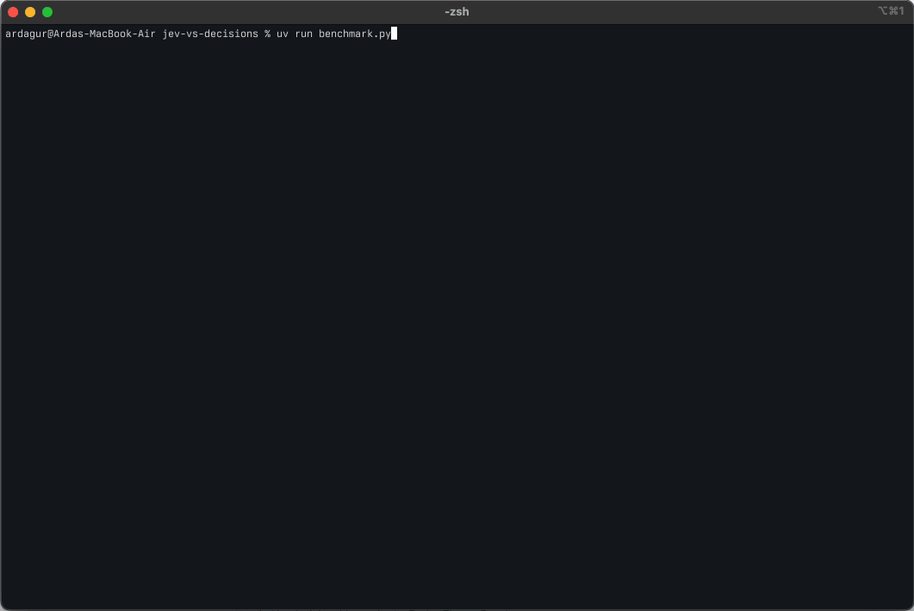
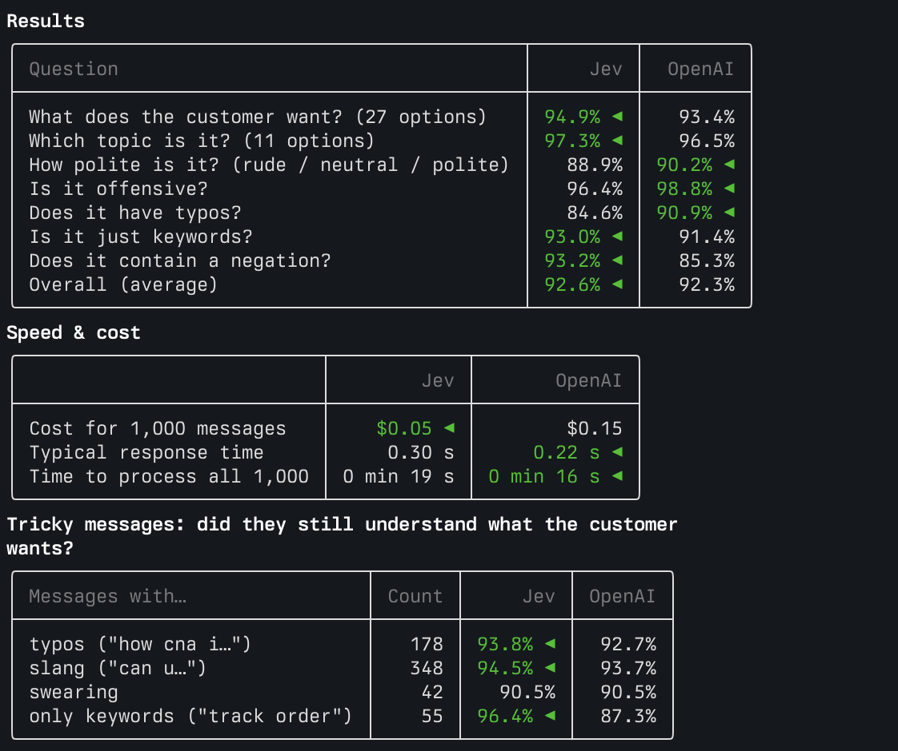
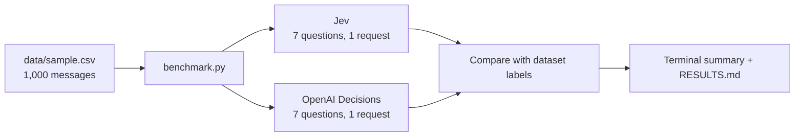

<h1 align="center">Jev vs OpenAI Decisions</h1>

<p align="center">
  <b>Same 1,000 messages. Same 7 questions. Two decision APIs.</b><br>
  A small benchmark of <a href="https://docs.typesafe.ai/introduction">TypeSafe Jev</a> and the
  <a href="https://developers.openai.com/api/docs/guides/decisions">OpenAI Decisions API</a>: accuracy, speed and cost.
</p>

<p align="center">
  
  
  
  
</p>

<p align="center">
  
</p>

---

## Results at a glance

|  | Jev (`jev-latest`) | OpenAI (`gpt-6-luna`) |
|---|---|---|
| **Overall accuracy** | **92.6%** | 92.3% |
| **Cost per 1,000 messages** | **$0.05** | $0.15 |
| **Typical response time** | 0.30 s | **0.22 s** |

Accuracy is nearly tied (Jev slightly ahead), Jev is **2.8× cheaper**, OpenAI is **1.4× faster**.
Per-question scores, tricky messages and confidence calibration are in **[RESULTS.md](RESULTS.md)**.

<p align="center">
  
</p>

> Numbers come from live models, so a new run may differ slightly.

## What is compared?

Both APIs read a piece of text and answer typed questions with **probabilities** instead of generated text.
They share the same three question types, and the benchmark uses all of them:

| Question type | Jev | OpenAI | Used for |
|---|---|---|---|
| Pick one option | `Choice` | `choice` | What does the customer want? Which topic is it? |
| Rate on a scale | `Score` | `score` | How polite is the message? |
| Yes / no | `Noul` | `predicate` | Is it offensive? Does it have typos? Is it just keywords? Does it contain a negation? |

## How it works



- Each message goes to **both APIs at the same time**, with the same 7 questions in **one request**.
- Answers are checked against the dataset's labels. The models never see the labels.
- Yes/no questions use **balanced accuracy**, so a model that always says "no" scores 50%, not 98%.

## Data

[Bitext Customer Support dataset](https://huggingface.co/datasets/bitext/Bitext-customer-support-llm-chatbot-training-dataset):
short customer messages labeled with 27 intents and tags for typos, slang, swearing and more.
A fixed sample of 1,000 messages (balanced across intents) is in [data/sample.csv](data/sample.csv).
The dataset is licensed under CDLA-Sharing-1.0.

## Run it yourself

### Prerequisites

- Python **3.12+**
- [uv](https://docs.astral.sh/uv/)
- A **TypeSafe API key** from the [TypeSafe console](https://console.typesafe.ai/keys)
- An **OpenAI API key** from the [OpenAI platform](https://platform.openai.com/api-keys)

### Install

```bash
git clone https://github.com/devardagur/jev-vs-decisions.git
cd jev-vs-decisions
uv sync
cp .env.example .env
```

Then open `.env` and add both keys:

```env
TYPESAFE_API_KEY=your-typesafe-api-key
OPENAI_API_KEY=your-openai-api-key
```

### Run the benchmark

Run all 1,000 messages:

```bash
uv run benchmark.py
```

Or try a quick run on fewer messages:

```bash
uv run benchmark.py --limit 100
```

`--concurrency` sets the parallel requests per provider (default `16`).
Each run prints a short comparison in the terminal and rewrites [RESULTS.md](RESULTS.md).

To rebuild the sample from the raw dataset:

```bash
uv run dataset.py
```

## Project structure

```text
jev-vs-decisions/
├── benchmark.py        # Runs both in parallel, prints the comparison, writes RESULTS.md
├── dataset.py          # Builds data/sample.csv and defines the 7 questions
├── jev.py              # Sends a message to Jev, returns answers, latency and cost
├── openai_client.py    # Same for OpenAI Decisions
├── data/
│   └── sample.csv      # The fixed 1,000-message sample
├── docs/               # README screenshot and demo GIF
├── RESULTS.md          # Full report from the latest run
├── .env.example        # Template for both API keys
├── pyproject.toml
└── uv.lock
```
